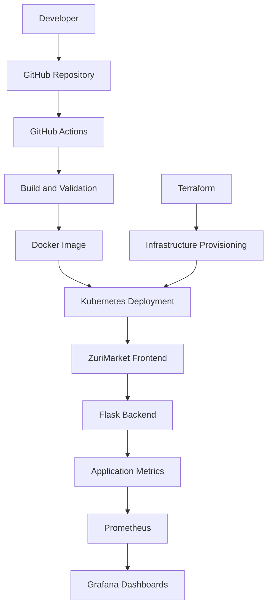

# ZuriMarket 

### A Cloud-Native Online Marketplace with DevOps Automation and Monitoring

ZuriMarket is an online marketplace application built with a modern application stack and DevOps practices. The project combines a web application with containerization, infrastructure as code, Kubernetes deployment configurations, continuous integration and delivery (CI/CD), and application and infrastructure monitoring.

The goal is to demonstrate how an application can be developed, packaged, deployed, monitored, and managed using tools commonly used in modern DevOps and cloud engineering.

## Table of Contents

- [Project Overview](#project-overview)
- [Architecture](#architecture)
- [Technology Stack](#technology-stack)
- [Project Structure](#project-structure)
- [How the Application Works](#how-the-application-works)
- [Prerequisites](#prerequisites)
- [Getting Started](#getting-started)
- [Running with Docker](#running-with-docker)
- [Running with Docker Compose](#running-with-docker-compose)
- [Deploying to Kubernetes](#deploying-to-kubernetes)
- [Infrastructure Provisioning with Terraform](#infrastructure-provisioning-with-terraform)
- [CI/CD with GitHub Actions](#cicd-with-github-actions)
- [Monitoring with Prometheus and Grafana](#monitoring-with-prometheus-and-grafana)
- [Environment Variables and Secrets](#environment-variables-and-secrets)
- [Troubleshooting](#troubleshooting)
- [Cleanup](#cleanup)
- [Future Improvements](#future-improvements)
- [Contributing](#contributing)

## Project Overview

ZuriMarket brings application development and infrastructure automation together in one project.

The project covers the following areas:

- **Frontend development:** A React application built with Vite.
- **Backend development:** A Python Flask application served with Gunicorn.
- **Containerization:** Docker packages the application and its runtime dependencies into a portable image.
- **Local orchestration:** Docker Compose runs the application and monitoring services together.
- **Container orchestration:** Kubernetes configuration files provide deployment resources for running the application in a cluster.
- **Infrastructure as Code (IaC):** Terraform configuration files define infrastructure provisioning.
- **Continuous Integration and Delivery:** GitHub Actions workflows automate configured development and deployment tasks.
- **Monitoring and observability:** Prometheus collects metrics, while Grafana provides dashboards for visualizing monitoring data.

The repository is intended to demonstrate how these technologies fit into an end-to-end DevOps workflow.

## Architecture

The following diagram illustrates the intended relationship between the application's components and the DevOps tools.



This diagram describes the intended deployment architecture. The exact automation steps, image registry, cloud provider, and infrastructure resources depend on the repository's Terraform configuration and GitHub Actions workflows.

### Architecture workflow

1. A developer pushes code changes to GitHub.
2. GitHub Actions executes the checks and automation defined in the repository's workflows.
3. Docker builds a container image containing the application.
4. Terraform provisions the infrastructure defined in its configuration.
5. Kubernetes deploys and manages application containers when a suitable cluster is configured.
6. Prometheus scrapes configured metrics endpoints.
7. Grafana visualizes the metrics collected by Prometheus.

Docker Compose provides a separate local environment for running the application and its monitoring services without requiring a Kubernetes cluster.

## Technology Stack

| Technology | Purpose |
|---|---|
| Python | Backend application language |
| Flask | Backend web framework |
| Gunicorn | Production-style WSGI application server |
| React | Frontend user interface |
| Vite | Frontend development and build tooling |
| Docker | Application containerization |
| Docker Compose | Local multi-container orchestration |
| Kubernetes | Container orchestration and deployment |
| Terraform | Infrastructure as Code |
| GitHub Actions | CI/CD workflow automation |
| Prometheus | Metrics collection and querying |
| Grafana | Metrics visualization and dashboards |
| Node Exporter | Host-level system metrics |
| Git | Source control and collaboration |

## Project Structure

The repository contains the following main directories and files:

```text
zurimarket/
├── .github/
│   └── workflows/       # GitHub Actions workflow definitions
├── frontend/            # React/Vite frontend application
├── kubernetes/          # Kubernetes deployment configuration
├── static/              # Static assets
├── terraform/           # Infrastructure as Code configuration
├── .dockerignore        # Files excluded from Docker build context
├── .gitignore           # Files excluded from Git
├── Dockerfile           # Multi-stage application image build
├── docker-compose.yml   # Application and monitoring services
├── app.py               # Flask backend application
├── prometheus.yml       # Prometheus scrape configuration
├── requirements.txt     # Python dependencies
└── README.md            # Project documentation
```

The files inside each directory are the source of truth for the actual deployment configuration. Review them before changing cloud infrastructure or deploying to a production environment.

## How the Application Works

### Frontend

The frontend is implemented with React and Vite.

During the Docker build, Node.js installs the frontend dependencies and creates a production build. The resulting static files are copied into the final application image.

### Backend

The backend is implemented in Python using Flask. Gunicorn serves the application on port `5000` inside the container.

The Dockerfile also configures a health-check command that checks the application's `/healthz` endpoint.

### Containerization

The Dockerfile uses a multi-stage build:

1. A Node.js stage builds the frontend.
2. A Python stage installs backend dependencies.
3. A final Python image combines the backend with the compiled frontend.

This approach separates build-time dependencies from the final runtime image. The configured application process runs as a non-root user.

## Prerequisites

Install the tools required for the deployment path you want to use.

| Tool | Required for |
|---|---|
| Git | Cloning the repository |
| Docker Engine or Docker Desktop | Building and running containers |
| Docker Compose | Running the local application and monitoring stack |
| Python 3.11 or compatible environment | Running the backend directly |
| Node.js 20 and npm | Running or building the frontend directly |
| `kubectl` | Managing Kubernetes resources |
| Access to a Kubernetes cluster | Kubernetes deployment |
| Terraform CLI | Infrastructure provisioning |
| Cloud CLI and credentials | Only if the selected Terraform configuration requires them |

Docker Compose is the easiest starting point because the repository already contains a Compose configuration.

## Getting Started

### 1. Clone the repository

```bash
git clone https://github.com/dammy123-ai/zurimarket.git
cd zurimarket
```

### 2. Inspect the repository

```bash
git status
git ls-files
```

Review the application, Docker Compose configuration, Terraform files, Kubernetes manifests, and GitHub Actions workflows.

### 3. Build and run the application

To start the application and monitoring services, follow the Docker Compose instructions below.

## Running with Docker

Build the application image from the repository root:

```bash
docker build -t zurimarket:local .
```

Run the container:

```bash
docker run --rm -p 5000:5000 zurimarket:local
```

Open the application at:

```text
http://localhost:5000
```

If the image starts successfully, verify its health endpoint:

```bash
curl -f http://localhost:5000/healthz
```

The endpoint should return a successful response if the application is healthy.

The Dockerfile exposes port `5000` inside the container. The host port can be changed by adjusting the port mapping.

## Running with Docker Compose

Docker Compose starts the application and the configured monitoring services together.

From the project root, run:

```bash
docker compose config
docker compose up --build -d
```

Check the running services:

```bash
docker compose ps
```

View application logs:

```bash
docker compose logs -f app
```

View all service logs:

```bash
docker compose logs -f
```

### Access the services

| Service | Local URL | Purpose |
|---|---|---|
| ZuriMarket | http://localhost | Application through the configured host port |
| Prometheus | http://localhost:9090 | Metrics collection and query interface |
| Grafana | http://localhost:3000 | Monitoring dashboards |

The Compose configuration maps host port `80` to application port `5000`. If port `80` is unavailable, modify the mapping in `docker-compose.yml`, for example to `8080:5000`, and access the application through `http://localhost:8080`.

The Compose configuration sets a Grafana administrator password using an environment variable. Replace the example password with a strong, locally managed secret before exposing the service.

To stop the stack:

```bash
docker compose down
```

## Deploying to Kubernetes

Kubernetes provides a way to run the application in a cluster and manage application replicas, networking, and container restarts.

### 1. Prepare a cluster

You can use a local Kubernetes environment or a cloud-managed cluster. For example, you may use Minikube or kind for local testing.

Confirm that `kubectl` is installed and configured:

```bash
kubectl version --client
kubectl config current-context
kubectl get nodes
```

The nodes command should return the nodes available in the selected cluster.

### 2. Review the Kubernetes manifests

Inspect the files in the `kubernetes/` directory.

Confirm that the manifests specify the correct:

- Container image and tag.
- Application port.
- Deployment and replica configuration.
- Service type and port mappings.
- Health-check endpoints.
- Image-pull settings, if an external registry is used.
- Environment variables and secret references.

If the manifests reference an image stored in a remote registry, build and push that image first.

### 3. Build and publish the image

For a registry such as Docker Hub, authenticate and tag the image using your own account and repository:

```bash
docker login
docker build -t YOUR_DOCKERHUB_USERNAME/zurimarket:latest .
docker push YOUR_DOCKERHUB_USERNAME/zurimarket:latest
```

Update the Kubernetes manifests to use the published image.

### 4. Deploy the manifests

After reviewing the manifests and confirming that the image reference is correct:

```bash
kubectl apply -f kubernetes/
```

Check the deployment:

```bash
kubectl get deployments
kubectl get pods
kubectl get services
```

Inspect a pod that is not starting correctly:

```bash
kubectl describe pod POD_NAME
kubectl logs POD_NAME
```

Replace `POD_NAME` with the actual pod name.

**Important:** These commands assume the directory contains applicable Kubernetes manifests. Check the files and any ordering requirements before applying them. The Kubernetes deployment path is separate from the Docker Compose workflow.

## Infrastructure Provisioning with Terraform

Terraform is the Infrastructure as Code tool in this project. It allows infrastructure to be defined in configuration files and provisioned in a repeatable, reviewable way.

The exact resources created by Zurimarket depend on the files inside the `terraform/` directory. Before running Terraform, identify the configured provider, required credentials, variables, and resources.

### 1. Install Terraform

Install Terraform using the official instructions:

https://developer.hashicorp.com/terraform/install

Verify the installation:

```bash
terraform version
```

### 2. Inspect the Terraform configuration

Navigate to the infrastructure directory:

```bash
cd terraform
```

List the configuration files:

```bash
ls -la
```

Review the `.tf` files and any accompanying documentation.

Identify:

- The cloud or infrastructure provider.
- Required provider versions.
- Required input variables.
- Resource definitions.
- Remote or local state configuration.
- Outputs and dependencies.
- Any networking, cluster, registry, or access requirements.

If the configuration provisions a Kubernetes cluster, ensure that you have the required cloud account, permissions, and networking prerequisites.

### 3. Initialize Terraform

```bash
terraform init
```

Terraform downloads the providers and modules required by the configuration.

### 4. Validate the configuration

```bash
terraform fmt -check
terraform validate
```

If formatting changes are needed, run:

```bash
terraform fmt -recursive
```

Run validation again afterward.

### 5. Configure variables

Use the variables declared in the Terraform configuration.

If the project requires a `terraform.tfvars` file, create one containing the actual required values. Do not invent variable names or provider settings; use the definitions in the repository.

Example of the format only:

```hcl
# terraform.tfvars
# Replace these illustrative entries with the variables
# actually declared by the project.

# example_region = "YOUR_REGION"
# example_name   = "zurimarket"
```

Do not copy these illustrative variables as working configuration unless they exist in the project's Terraform files.

Keep credentials out of source control. Add local variable files containing secrets to `.gitignore` where appropriate.

### 6. Preview the infrastructure changes

```bash
terraform plan
```

Review the proposed changes carefully. Confirm that Terraform will create, update, or delete only the intended resources.

### 7. Provision the infrastructure

Once the configuration, credentials, and plan have been reviewed:

```bash
terraform apply
```

Confirm the proposed changes when prompted.

Terraform will create or modify only the resources described by the active configuration and permitted by your credentials.

### 8. Review outputs and configure Kubernetes access

After provisioning, inspect any declared outputs:

```bash
terraform output
```

If the configuration creates a Kubernetes cluster, follow the provider-specific instructions to configure the `kubectl` context. Do not assume that the cluster credentials are configured automatically unless the Terraform code explicitly handles this.

Verify access:

```bash
kubectl get nodes
```

Then deploy the Kubernetes manifests according to the cluster setup instructions.

### Terraform state and safety

Terraform state tracks the resources managed by Terraform. Treat it as sensitive because it can contain infrastructure details and potentially secret values.

- Do not commit sensitive state files or credentials.
- Use a properly secured remote backend for shared or production infrastructure when appropriate.
- Enable state locking where supported.
- Review every plan before applying it.
- Do not run Terraform against an unfamiliar or production environment without understanding the impact.

The Terraform commands above describe the standard workflow. The precise cloud provisioning steps depend on the provider and resources implemented in the repository.

## CI/CD with GitHub Actions

GitHub Actions automates development and delivery tasks through workflow files stored under:

```text
.github/workflows/
```

The actual triggers, jobs, and deployment steps are determined by those YAML files.

### Typical CI/CD workflow

A container-based pipeline can follow this process:

1. A developer pushes a commit or opens a pull request.
2. GitHub Actions checks out the repository.
3. The workflow installs the required dependencies.
4. The workflow performs the configured validation and build steps.
5. Docker builds the application image.
6. If configured, the workflow authenticates to a container registry and pushes the image.
7. If deployment is configured, the workflow deploys the image to the target environment.

The steps above describe a common pipeline, not a guarantee that every step is currently implemented in the repository.

### Configure GitHub Actions

1. Open the repository on GitHub.
2. Select the **Actions** tab.
3. Review the available workflows and their execution history.
4. Read each workflow to identify its required environment variables, secrets, permissions, and deployment target.
5. Add only the secrets required by the actual workflow under the repository's **Settings → Secrets and variables → Actions**.
6. Trigger the workflow using its configured event or supported manual trigger.

Potential secrets in a container publishing or cloud deployment workflow may include a registry token or cloud authentication credentials. Use the exact names referenced by the workflow rather than creating arbitrary secrets.

### Recommended pipeline improvements

For a production-oriented pipeline, consider implementing:

- Automated backend and frontend tests.
- Docker image builds and vulnerability scanning.
- Image tagging based on the commit SHA or release version.
- Authentication using short-lived cloud credentials where supported.
- Automated deployment after successful validation.
- Deployment health checks and rollback procedures.
- Separate staging and production environments.
- Restricted workflow permissions and protected deployment environments.

## Monitoring with Prometheus and Grafana

ZuriMarket includes a monitoring stack in its Docker Compose configuration.

### Prometheus

Prometheus collects time-series metrics by scraping configured targets at regular intervals.

The repository's `prometheus.yml` sets a scrape interval of 15 seconds and defines targets for:

- `app:5000` — the application.
- `localhost:9090` — Prometheus itself.
- `node-exporter:9100` — Node Exporter.

These targets are defined in the Compose-oriented configuration. The application and monitoring services must be reachable at the configured addresses for scraping to succeed.

Open Prometheus at:

http://localhost:9090

Visit **Status → Targets** to check whether the configured targets are up.

If the application does not expose a Prometheus-compatible metrics endpoint, the application scrape target will need an appropriate metrics endpoint or exporter configuration before it can provide application metrics.

### Grafana

Grafana provides dashboards for exploring and visualizing metrics.

Open Grafana at:

http://localhost:3000

Sign in using the credentials configured for the Grafana service. For the supplied Compose configuration, the administrator password is set through `GF_SECURITY_ADMIN_PASSWORD`.

Configure Prometheus as a Grafana data source if it is not already configured. When Grafana runs inside the same Compose network, the internal Prometheus service address is generally:

```text
http://prometheus:9090
```

A monitoring dashboard can display useful metrics such as:

- Application availability.
- Request volume and response latency, if exposed.
- HTTP error rates, if instrumented.
- Host CPU and memory utilization from Node Exporter.
- Prometheus target health.

The availability of each metric depends on the relevant exporter, application instrumentation, and scrape configuration.

### Node Exporter

Node Exporter exposes host-level system metrics, allowing Prometheus to collect information about CPU, memory, and other operating-system resources.

The supplied Compose configuration mounts host system paths for Node Exporter. Review these mounts and permissions carefully, particularly on non-Linux hosts or production machines.

### Production monitoring considerations

For production, configure persistent storage, appropriate access controls, secure credentials, alerting, and reliable retention policies. Do not expose Prometheus or Grafana publicly without authentication and network restrictions.

## Environment Variables and Secrets

The project already defines an application environment setting in its Docker Compose configuration.

Before deploying to another environment:

1. Review `app.py` and `requirements.txt` for application dependencies and configuration.
2. Review the Dockerfile and Compose file for runtime settings.
3. Review Kubernetes manifests for environment variables and secret references.
4. Review Terraform variables and GitHub Actions workflows for deployment credentials.
5. Supply the required values through the appropriate environment or secret-management mechanism.

Never commit API keys, passwords, cloud credentials, access tokens, or production secrets to GitHub.

For a public repository, use GitHub Actions secrets for CI/CD credentials and an appropriate secret-management solution for deployed workloads.

## Troubleshooting

### Docker build fails

Check that Docker is running and that the frontend package files and Python dependency files are present.

```bash
docker build -t zurimarket:local .
```

Review the build output to identify the failed stage.

### Application is unavailable

Check the container status and logs:

```bash
docker compose ps
docker compose logs app
```

Verify the port mapping and health endpoint:

```bash
curl -f http://localhost/healthz
```

This URL assumes the default Compose mapping of host port `80` to application port `5000`.

### Prometheus target is down

Check the Prometheus configuration and service names:

```bash
docker compose logs prometheus
docker compose ps
```

Verify that the application or exporter exposes the expected endpoint and is reachable from Prometheus.

### Grafana cannot query Prometheus

Confirm that Prometheus is running and that the Grafana data source uses the correct address for the environment. Inside Docker Compose, use the service name rather than `localhost` for another container.

### Kubernetes pods fail to start

Inspect the pods, events, and logs:

```bash
kubectl get pods
kubectl get events --sort-by=.metadata.creationTimestamp
kubectl describe pod POD_NAME
kubectl logs POD_NAME
```

Check the image name, image-pull permissions, resource requests, environment variables, and health probes.

### Terraform fails

Run the following commands from the Terraform configuration directory:

```bash
terraform init
terraform validate
terraform plan
```

Check provider credentials, required variables, provider versions, backend access, and the cloud account or workspace selected.

### GitHub Actions fails

Open the failed workflow run in the GitHub Actions tab. Review the failing job's logs, permissions, missing secrets, registry authentication, and deployment configuration.

## Cleanup

### Stop local containers

```bash
docker compose down
```

To remove the containers and networks created by Compose, use the command above. Persistent data is not necessarily removed.

### Remove Kubernetes resources

If the resources were created from the repository's Kubernetes directory and you have confirmed that the directory contains the resources you want to remove:

```bash
kubectl delete -f kubernetes/
```

Review the impact before running this command against a shared cluster.

### Destroy Terraform-managed infrastructure

From the Terraform configuration directory:

```bash
terraform plan -destroy
```

Review the proposed destruction carefully. If the plan is correct and you have confirmed that the resources can be safely removed, run:

```bash
terraform destroy
```

This can delete real cloud resources and associated data. Never run it against shared or production infrastructure without explicit authorization and a verified recovery plan.

## Future Improvements

Potential areas for extending the project include:

- Automated unit, integration, and frontend tests.
- A complete container registry publishing workflow.
- Automated Kubernetes deployment from GitHub Actions.
- Separate development, staging, and production environments.
- Terraform remote state and locking.
- Kubernetes autoscaling and resource limits.
- Application-level Prometheus instrumentation.
- Grafana dashboards and alerting rules.
- Container image vulnerability scanning.
- Centralized log collection.
- Secret management and short-lived deployment credentials.
- Automated health checks and deployment rollback.

These are improvement opportunities and should not be interpreted as features that are already implemented.

## Contributing

Contributions and suggestions are welcome.

1. Fork the repository.
2. Create a feature branch.
3. Make your changes.
4. Test the application and any affected infrastructure configuration.
5. Submit a pull request with a clear description of the changes.

For infrastructure changes, include the Terraform plan or a summary of the expected impact where appropriate. Never include secrets, state files, or credentials in a pull request.

## Repository

GitHub: https://github.com/dammy123-ai/zurimarket/

## License

Add the applicable license information here if the project has a license. Do not assume that the project is open source under a particular license without checking the repository's license file.

---

**ZuriMarket — Building an online marketplace with application development, Infrastructure as Code, containerization, CI/CD, and observability.**
